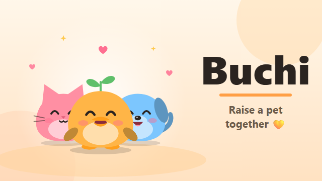
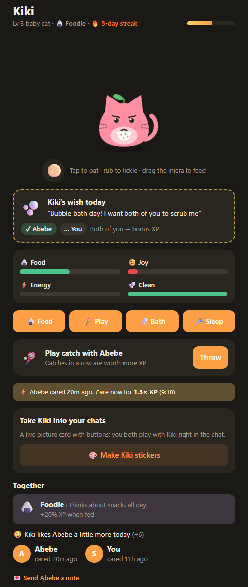
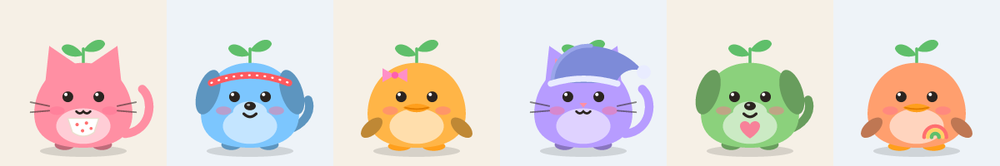
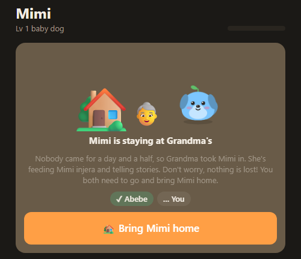
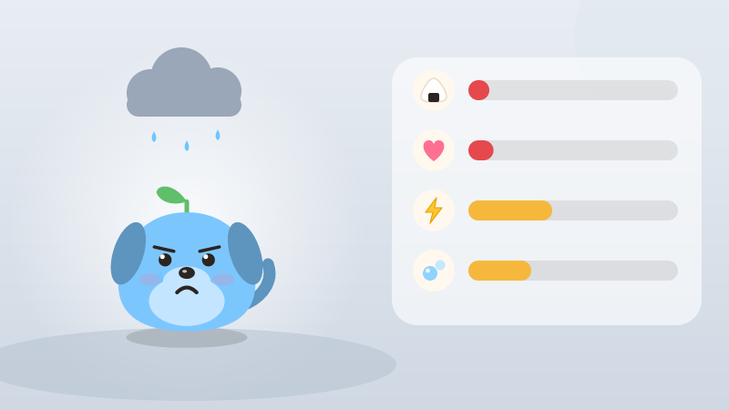
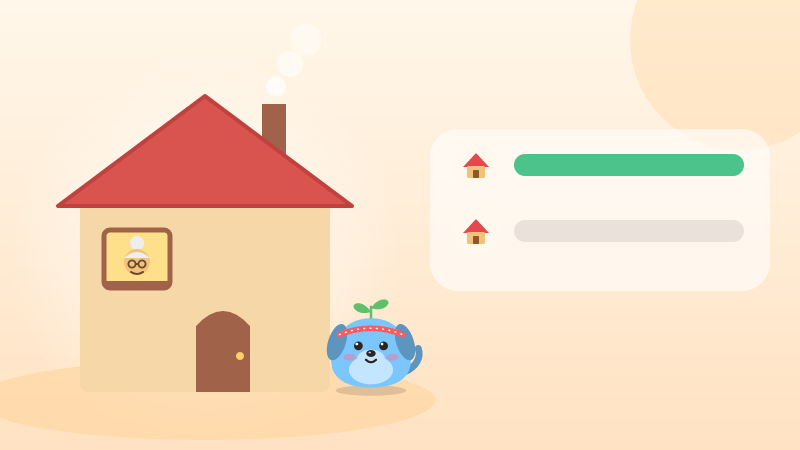
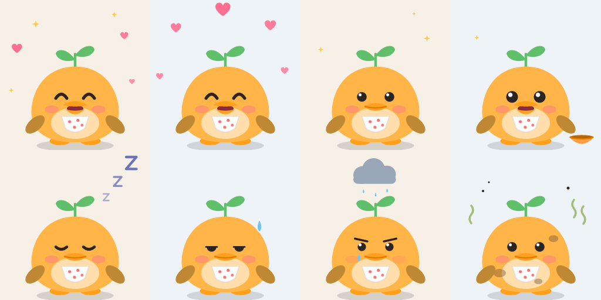

  

<h1 align="center">Buchi 🐣</h1>

  <b>A little pet you raise together with a friend, right inside Telegram.</b> 
  <a href="https://t.me/Buchip_bot"><b>▶ Play now: @Buchip_bot</b></a>

---

Buchi is a co-op pet game. You and one buddy adopt an egg, hatch it together and raise it. It gets hungry, sleepy, dirty and lonely in real time, so it needs **both** of you. It lives in a Telegram Mini App, and it can also move into your chats as a live picture card you both play with.

This page explains how to play. (The game's source code is private.)

**Contents:** [Getting started](#getting-started) · [Caring](#caring-for-your-pet) · [Playing together](#playing-together) · [Growing up](#growing-up) · [Personality](#personality) · [Grandma](#grandma-) · [Buchi in your chats](#buchi-in-your-chats) · [Commands](#bot-commands) · [Tips](#tips) · [FAQ](#faq)

---

## Getting started

1. Open **[@Buchip_bot](https://t.me/Buchip_bot)** in Telegram and press **Start**.
2. Tap **Open Buchi**. Pick a **duck, cat or dog**, choose a color and give it a name.
3. You get an **egg** 🥚. Tap **💌 Invite buddy** and send the link to a friend.
4. When your friend opens the link, they join as your buddy. **Both of you** tap the egg to keep it warm. It only hatches once you've both done your part.
5. 🐣 It hatches. Now you raise it together.

> Tip: allow Buchi to message you (the 🔔 button in the app). It will tell you when your pet needs you, when your buddy does something, and when there's a ball to catch.

## Caring for your pet

Your pet has four needs. Each one goes down slowly over time, even when the app is closed:

| Need | What fills it | Goes down by about |
|---|---|---|
| 🍙 **Food** | Feed it | 5 per hour |
| 😊 **Joy** | Play, pats, notes, catch | 4 per hour (twice as fast when hungry or dirty) |
| ⚡ **Energy** | Tuck it in to sleep | 3 per hour (sleeping restores 12 per hour) |
| 🫧 **Clean** | Give it a bath | 3 per hour |

**Ways to care:**

| | How | Wait before doing it again |
|---|---|---|
| 🍙 **Feed** | Tap Feed, or **drag the injera 🫓 to its mouth** | 15 min |
| 🎾 **Play** | Tap Play | 10 min |
| 🫧 **Bath** | Tap Bath, or **rub a dirty pet** until it's clean | 30 min |
| 💤 **Sleep / ☀️ Wake** | Tap Sleep when it's tired (wakes up on its own when rested) | — |
| 💛 **Pat** | **Tap the pet**. Rub it to tickle! | 20 sec |

Your pet also reacts on its own: it blinks, hops, sneezes when it's dirty, follows your finger with its eyes, and watches the odd butterfly 🦋. Its face shows how it feels: joyful, content, hungry, dirty, tired, sleepy or sad.

## Playing together

Everything is better with your buddy:

- **⚡ Combo.** If your buddy cared in the last **30 minutes**, your care earns **1.5× XP**. The app shows a countdown.
- **🔥 Streak.** Every day you **both** care, your shared streak grows. Each streak day adds **+5% XP** (up to +50% at 10 days). Miss a day and it starts over.
- **⭐ Daily wish.** Each day your pet wishes for one thing from *both* of you: *"Cuddles from both of you"*, *"Bubble bath day!"*, *"Kolo time! A handful from each of you"*, *"Play catch together"*… When you've both done it, the wish comes true: **bonus XP** and a big boost of joy.
- **🎾 Pass the ball.** Throw the ball and your buddy gets a ping: they have **3 hours** to catch it. Catches in a row build a **rally**, and a longer rally is worth more XP. Drop it and the rally starts again.
- **💌 Notes.** Write your buddy a short note (up to 140 characters) and add a little gift if you like (🍪 🌸 ☕ 🎈 ⭐ 🍯). Your pet carries it over and shows up holding an envelope. Your buddy only sees the note when they open it, and you can see when it's been read.
- **💬 Chat with your pet.** Write to @Buchip_bot and your pet answers, depending on its mood (and personality). Chatting cheers it up a little.

## Growing up

Care earns **XP**, and XP raises your pet's **level**. As it levels up, it grows:

| Stage | Levels | XP needed for the level |
|---|---|---|
| 🥚 Egg | until both buddies warm it | — |
| Baby | 1 – 3 | Level 2 at 50 XP, level 3 at 200 XP |
| Kid | 4 – 7 | Level 4 at 450 XP … |
| Teen | 8 – 12 | Level 8 at 2,450 XP … |
| Adult 🌼 | 13+ | Level 13 at 7,200 XP |

Rough XP per care: feed 10, play 15, bath 10, sleep 5, pat 1, catch 10+ (more in a rally), wish 40. Combos, streaks and personality add more.

## Personality

How you two care for your pet shapes **who it becomes**. After about a dozen cares, its personality appears, based on what you do most. Each one wears its own accessory and has a small perk:

| Personality | Comes from | Wears | Perk |
|---|---|---|---|
| 🍙 **Foodie** | feeding | a dotted bib | +20% XP when fed |
| ⚡ **Zoomy** | playing and catch | a sporty headband | +20% XP for play and catch |
| ✨ **Neat** | baths | a pink bow | +20% XP for baths |
| 💤 **Sleepyhead** | tucking in | a nightcap | +20% XP for sleep |
| 💛 **Cuddly** | lots of pats | a heart | pats give extra joy |
| 🌈 **All-rounder** | a bit of everything | a rainbow badge | +5% XP for everything |

Personalities aren't fixed. If your habits change, your pet can change too. It also talks a little differently: a Foodie might tell you *"I dreamt about injera again 🫓"*.

**😏 Favorite today.** Whoever cared clearly more today becomes the favorite: *"Kiki likes Sara a little more today (+4)"*. It resets every day, so it's always up for grabs.

## Grandma 👵

Your pet is **never lost**. But if **nobody** looks after it for about **a day and a half**, and its food and joy are empty, it goes to stay with **Grandma** for a while.

- At Grandma's, nothing goes down: she feeds it injera and tells it stories.
- To bring it home, **both of you** have to go and get it: each buddy taps **🏡 Bring home**.
- It comes back fed, clean and happy. You keep all its XP, level and personality.

A busy day is fine. Grandma only steps in after a day and a half of nothing.

## Buchi in your chats

Your pet doesn't have to stay in the app. It can **live in your chats** as a **live picture card**: a picture of your pet in its current mood with its stats, plus buttons you both can tap. Every tap updates the same card for both of you, in place.

  
  

  
  

The card has **🍙 Feed · 🎾 Play · 🫧 Bath · 💛 Pat · 💤 Sleep · 🥎 Throw/Catch** and **✨ Open Buchi**. If someone else in the chat taps a button, nothing happens to your pet. Only its two buddies can care for it.

**Ways to bring your pet into a chat** (in the app, under *Take … into your chats*):

| | How | Works on |
|---|---|---|
| 🖼️ **Send to a chat** | Tap it and choose the chat with your buddy | Up-to-date Telegram |
| ⌨️ **Inline** | In any chat, type `@Buchip_bot ` (with a space) and tap the picture | Most Telegram apps |
| 💬 **In your bot chat** | Send `/pet` to @Buchip_bot (or *Send the card to my Buchi chat* in the app) | Every Telegram version |
| 👥 **A group with your buddy** | Tap **Add to a group**, or add @Buchip_bot to a group and send `/pet` | Every Telegram version |

**In a group**, your pet really lives there. Besides the card, it **speaks up on its own**: it says when it's hungry or lonely, and it celebrates when it hatches, grows up or gets its wish.

### Your pet's own stickers 🎨

Tap **Make stickers** in the app, or send `/stickers` to the bot. Your pet gets its **own Telegram sticker pack** in 8 moods. It wears its personality's accessory, and the pack is **redrawn when your pet grows up**, for everyone who added it.

## Bot commands

| Command | What it does |
|---|---|
| `/start` | Meet Buchi and open the app |
| `/pet` | Post your pet's live card in this chat (your bot chat or a group) |
| `/stickers` | Get your pet's sticker pack |
| *any message* | Chat with your pet; it answers depending on its mood |

## Tips

- **Care at the same time as your buddy** for the ⚡ 1.5× combo. Start an action, then ping your buddy.
- **Keep the streak alive.** One care each per day is enough to grow it.
- **Check today's wish** first thing. It's the biggest XP of the day.
- **Don't let the ball drop.** Long rallies pay off.
- **Pick your personality.** Feed a lot for a Foodie, play a lot for a Zoomy…
- **Put your pet in a group** with your buddy, so you both see its reminders in one place.
- You can raise **up to 5 pets**, each with its own buddy.

## FAQ

**Can I play alone?**
An egg needs two buddies to hatch. Buchi is made for raising a pet *together*.

**Can three people raise one pet?**
No, each pet has exactly two buddies. But you can have up to 5 pets with different friends.

**Does my pet die if I forget it?**
Never. After a day and a half without care it goes to stay with Grandma, and you both bring it home together.

**I typed `@Buchip_bot` but nothing appears.**
Some Telegram apps or networks don't load inline results (try `@gif cat`. If that doesn't work either, it's not Buchi). Use **Send to a chat** in the app, `/pet`, or a group instead.

**What does Buchi know about me?**
Your Telegram name, username and profile photo (to show your buddy who cared), your pets and what you did with them, and the notes you send your buddy (so your pet can deliver them). In groups, the bot only reads commands such as `/pet`, not your conversation.

**How do I get help or suggest something?**
Open an [issue](../../issues) on this page.

---

Made with 💛 · Buchi's characters, art and game design © 2026, all rights reserved.

